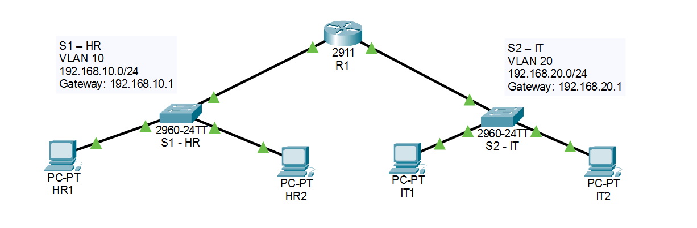
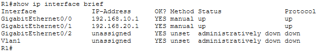
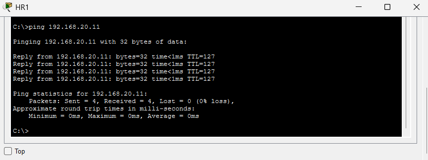

# small-office-network-simulation
## Overview
This project was created using Cisco Packet Tracer to practise basic network configuration and routing. The network represents a small office with two departments, Human Resources (HR) and IT.

Each department has its own switch and VLAN, with a router connecting both networks to allow communication between them.

## Network Topology

The network consists of:
- 1 Cisco 2911 router
- 2 Cisco 2960 switches
- 4 PCs (2 per department)

## Network Configuration
The two departments are assigned separate VLANs and IP subnets.
| Department | VLAN | Network | Default Gateway |
|------------|------|---------|-----------------|
| HR         | 10   | 192.168.10.0/24 | 192.168.10.1 |
| IT         | 20   | 192.168.20.0/24 | 192.168.20.1 |

IP Address Assignment
| Device | IP Address |
|--------|------------|
| HR1    | 192.168.10.11 |
| HR2    | 192.168.10.12 |
| IT1    | 192.168.20.11 |
| IT2    | 192.168.20.12 |

Both switches were configured with their respective VLANs. The router uses two physical interfaces, one for each department, to route traffic between the networks.

## Testing
After configuring the devices, I used ping commands to check whether the PCs could communicate within and across departments.

| Test | Result |
|------|--------|
| HR1 to HR2 | Successful |
| IT1 to IT2 | Successful |
| HR1 to IT1 | Successful |
| IT1 to HR1 | Successful |

I also used show vlan brief to verify the VLAN assignments on both switches and show ip interface brief to check the router interfaces.

All final connectivity tests were successful.

### Router Interface Status
The router interfaces were checked using `show ip interface brief`. Both interfaces were up and assigned the correct IP addresses.

### Inter-VLAN Connectivity
A ping test from HR1 to IT1 was successful, with 4 packets received and 0% packet loss.

## Troubleshooting
During testing, HR1 could communicate with HR2 but could not reach IT1.

After checking the router configuration, I found that the IP addresses assigned to the two router interfaces were reversed. I corrected the interface addresses and tested the connection again.

The first ping initially had one timeout, but subsequent tests completed without packet loss.

## What I Learned
This project helped me better understand how VLANs separate devices into different networks and how a router allows communication between those networks.

It also gave me some hands-on practice with Cisco CLI commands, configuring switch ports, assigning IP addresses and troubleshooting connectivity issues.

## Project File
The completed simulation is available in Small_Office_Network.pkt and can be opened using Cisco Packet Tracer.
